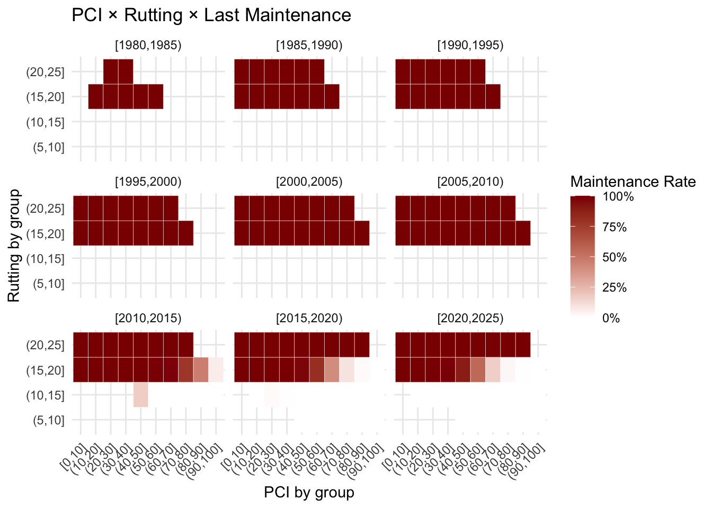

# Yu-Hsuan Huang

### Statistics · Data Analysis · Model Evaluation

I am a master's student in Statistics at National Taiwan University, with a bachelor's degree in Quantitative Finance from National Tsing Hua University. My coursework projects focus on using statistical models and visualizations to investigate practical questions and communicate findings.

My main tools are **R, Orange, and Excel**, with basic knowledge of **Python and SQL**. I am interested in data science and applied machine learning opportunities where careful evaluation and clear reasoning matter.

## Selected projects

| Project | Focus | Tools |
| --- | --- | --- |
| [Road Maintenance Analysis](projects/road-maintenance/README.md) | Explore 999,999 pavement records, fit a logistic regression, and develop a maintenance priority score | R, tidyverse, ggplot2 |
| [Student Performance Classification](projects/student-performance/README.md) | Compare three classifiers, inspect class-level errors, and review evaluation limitations | Orange, Excel |

### Road Maintenance Analysis

Investigated how pavement condition, rutting, roughness, rainfall, traffic volume, and maintenance history relate to maintenance needs. Combined exploratory plots with a logistic regression and an interpretable priority score.

[Read the project →](projects/road-maintenance/README.md)

### Student Performance Classification

Prepared GPA categories, compared Decision Tree, Naive Bayes, and kNN models, and examined confusion matrices. A review of the saved coursework also identifies target leakage and inconsistent evaluation settings that need to be addressed before making generalization claims.

[Read the project →](projects/student-performance/README.md)

## Technical background

- **Statistical methods:** exploratory data analysis, logistic regression, classification, cross-validation, and confusion matrix analysis.
- **Communication:** analytical reports and visual explanations of model results and limitations.
- **Education:** M.S. program in Statistics, National Taiwan University (2026–present; expected 2028); B.S. in Quantitative Finance, National Tsing Hua University (2026).

## About this portfolio

These are coursework case studies. Project pages distinguish completed work from proposed improvements. Reported historical scores have not been reproduced in this repository. Individual survey responses and serialized student models are not distributed here.
