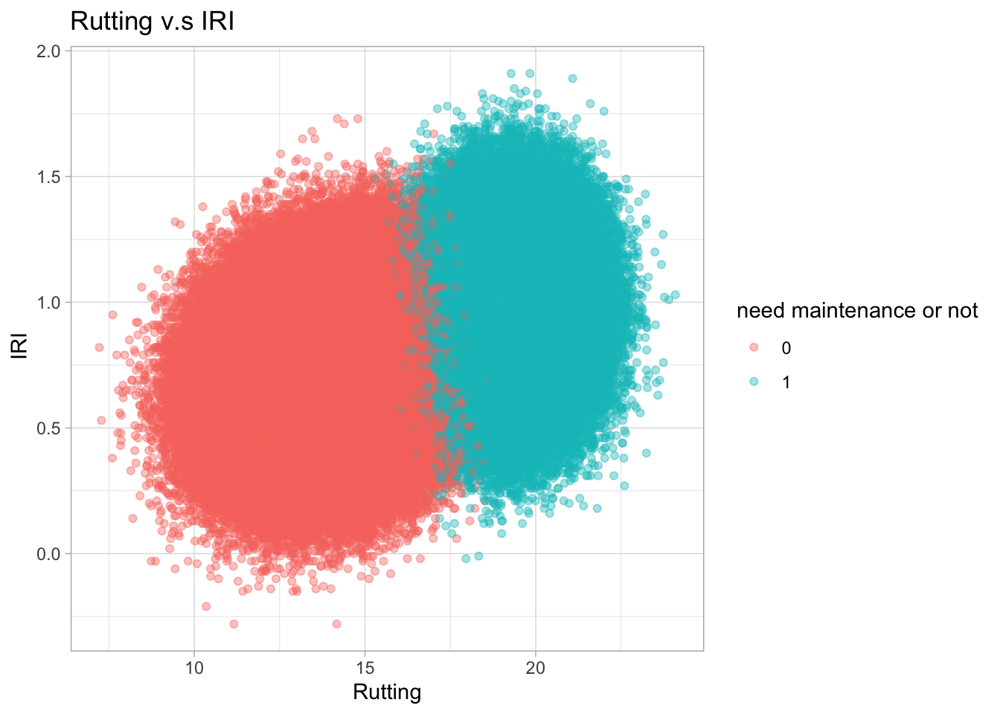
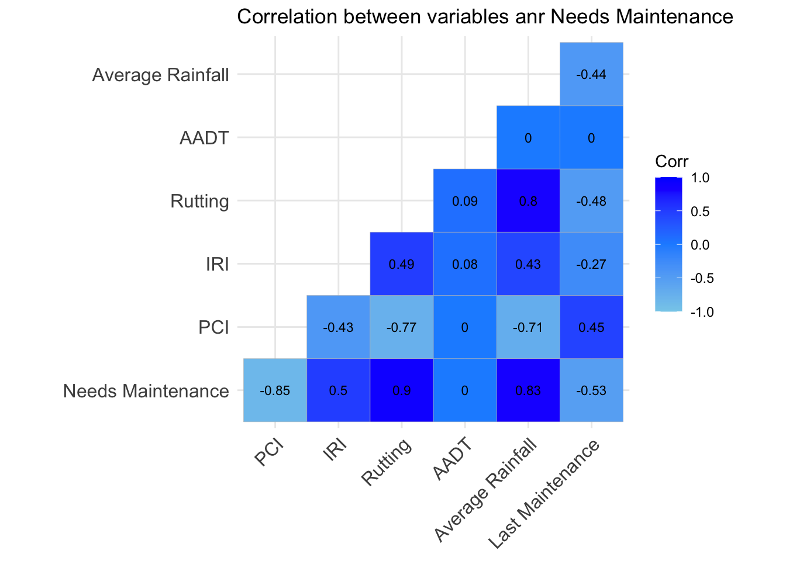
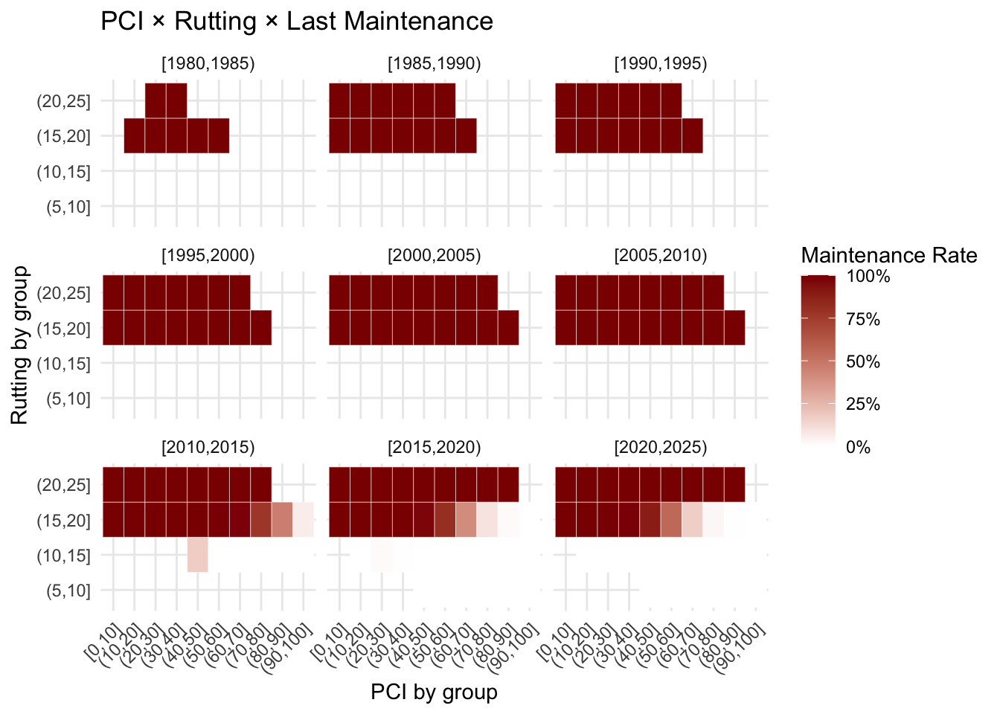

# Road Maintenance Analysis

**R · Exploratory Data Analysis · Logistic Regression · Decision Support**

## Overview

Road repairs compete for limited resources. This coursework project explores which pavement indicators are associated with maintenance needs and how they might inform a transparent ranking of road segments for inspection.

The original analysis loaded **999,999 records and 10 columns** from a pavement dataset. I used R to explore the data, visualize relationships, fit a logistic regression, and construct a heuristic priority score. The project demonstrates an analytical workflow; the score has not been validated for operational use.

## Data and question

The binary target is `Needs Maintenance` (0 or 1). The available fields include pavement condition index (`PCI`), rutting, international roughness index (`IRI`), annual average daily traffic (`AADT`), average rainfall, last maintenance year, road type, asphalt type, and segment ID.

The source is described as a Kaggle dataset in my CV. The exact dataset URL and redistribution license are not available in the supplied project materials, so the underlying CSV is not included. The analysis is not established as a study of Taiwanese road observations.

## Work completed

1. Inspected column types and distributions with `glimpse()` and `summary()`.
2. Compared continuous indicators using scatter plots and Pearson correlations.
3. Explored category composition by maintenance status.
4. Binned PCI and rutting and compared maintenance proportions across five-year maintenance periods; retained heatmap cells with at least 10 records.
5. Fitted a binomial logistic regression using six numeric predictors after dropping missing values.
6. Created a heuristic priority score and displayed the 20 highest-ranked segments.

## Visual findings



Road segments labeled as needing maintenance occupy a visibly different region of rutting values. This is an association within the dataset and does not establish a causal effect.



The report's rounded correlations with the maintenance label include **PCI −0.85**, **rutting +0.90**, and **IRI +0.50**. Correlated predictors and the label-generation process need investigation before interpreting these as independent predictive signals.



The original heatmap highlights combinations of low PCI and deeper rutting with high observed maintenance proportions. The thresholds discussed in the report, such as PCI below 40 and rutting above 15, are exploratory observations rather than validated intervention rules. These are cross-sectional proportions, not estimates of future deterioration risk.

## Logistic regression

The original model uses:

```r
Needs_Maintenance ~ PCI + Rutting + IRI + AADT + Average_Rainfall + Last_Maintenance
```

Names above are simplified for readability; the extracted R source retains the original column names.

| Predictor | Estimated coefficient, approximately |
| --- | ---: |
| PCI | −0.1964 |
| Rutting | +3.329 |
| IRI | +4.254 |
| AADT | −0.00005552 |
| Average rainfall | +0.2180 |
| Last maintenance year | −0.6079 |

These are coefficients from the original fitted model, not results of a new run. Predictors have different units, so raw coefficient magnitudes should not be used to rank feature importance.

The original fit emitted a warning that fitted probabilities were numerically 0 or 1. This warrants checks for separation, label construction, and model stability. Statistical significance in this large sample is not a substitute for out-of-sample performance.

## Maintenance priority score

The original report proposes:

```text
Priority score = −0.5 × PCI + 0.3 × Rutting + 0.2 × Average rainfall
```

The weights were manually chosen; they were not learned by the logistic regression. Because inputs have different scales, the weights do not directly represent relative importance. This is a transparent prototype for discussing prioritization, not a calibrated probability or an optimized allocation policy.

## Limitations and next steps

- **Evaluation:** no held-out accuracy, ROC-AUC, calibration analysis, or operational benefit is provided in the original report.
- **Data quality:** the original summary contains negative traffic and roughness values, and maintenance years beyond the report year. Their meaning and validity need checking before further modeling.
- **Interpretation:** category composition within maintenance groups is different from the maintenance rate within each category. The original material also contains inconsistent asphalt-type interpretations; no material-specific recommendation is claimed here.
- **Time coverage:** the heatmap code uses intervals from 1980 up to, but excluding, 2025. Years outside that range are omitted from the plot.
- **Planned improvement:** confirm provenance, audit the target, create an appropriate holdout split, compare a simple baseline, and evaluate discrimination and calibration. None of these additional experiments is claimed as completed.

## Files and reproducibility

- `assets/`: original figures extracted from the submitted HTML report.
- `analysis-original.R`: R code blocks extracted from that report, in their original order.

The extracted source has not been rerun. It expects a local `pavement.csv`; the data is not supplied. It also retains the original package installation statements and exploratory code. Review it before running it in an R environment. No new performance result is claimed.

[Back to portfolio](../../README.md)
