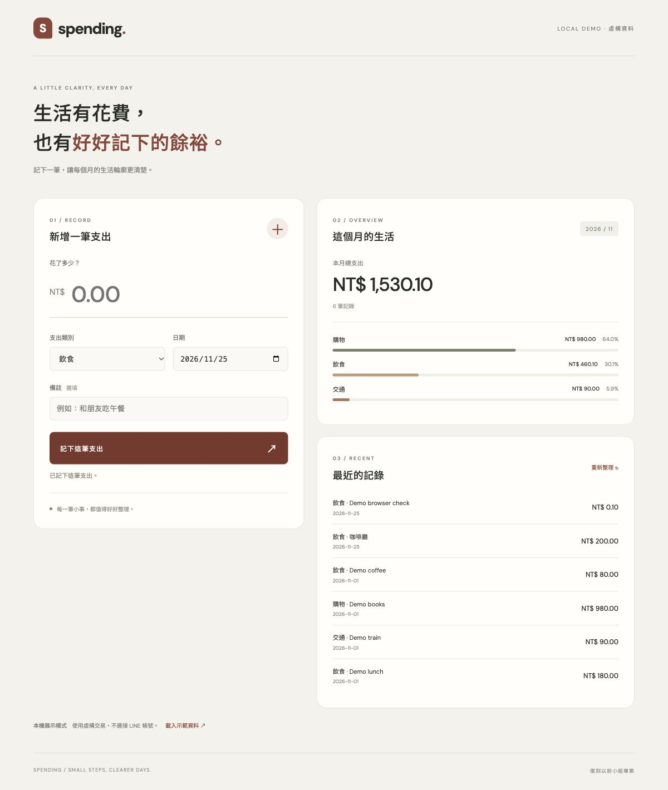
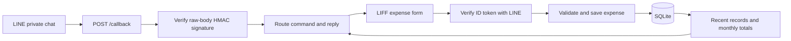

# Spending — Python LINE Expense Bot

**復刻以前小組專案 · A Python recreation of a previous group project**

A LINE bot for recording expenses and understanding monthly spending. This version recreates the recording and analysis workflow of a previous group project using **Python, Flask, LIFF, and SQLite**. It includes a mobile-friendly form, user-scoped records, category summaries, and an isolated local demonstration mode.



*Local demonstration using fictional transactions. This is the LIFF-style web interface, not proof of a deployed LINE channel.*

## Features

| LINE command | Behavior |
| --- | --- |
| `記帳` or `@recording` | Replies with a LIFF link to the expense form |
| `明細` | Shows the latest 10 records for the verified user |
| `分析` or `@analyze` | Shows this month's total and category amounts, percentages, and ranking |
| Any other text | Replies with command help |

The form accepts category, date, amount, and an optional note. All amounts are in **New Taiwan dollars (NT$)**, stored as integer cents. Monthly boundaries follow **Asia/Taipei**. The bot handles private one-to-one conversations; group messages are ignored.

This release implements recording and analysis. Scheduled reminders, budget alerts, automatic bank imports, OCR, and AI classification are outside its scope.

## Try it locally without LINE credentials

Requires Python 3.11 or later. Run these commands **from this project directory**:

```bash
python -m venv .venv
source .venv/bin/activate
python -m pip install -r requirements.txt
DEMO_MODE=1 DATABASE=instance/demo.sqlite3 python app.py
```

Open [the local demo](http://127.0.0.1:5050/). Click **載入示範資料** to load four fictional transactions, then try recording a new expense. Repeatedly loading the same month's seed data does not duplicate it.

On Windows PowerShell, activate `.venv\Scripts\Activate.ps1`, set `$env:DEMO_MODE="1"` and `$env:DATABASE="instance/demo.sqlite3"`, then run `python app.py`.

Demo mode uses a single fictional identity and does not authenticate LINE users. It disables the webhook and is intended for a loopback-only local demonstration. **Never publish demo mode on an internet-facing service.**

## Connect your LINE channel

1. Create a LINE Official Account and enable its Messaging API. Obtain the Messaging API channel secret and channel access token.
2. Under the **same LINE provider**, create a LINE Login channel and add a LIFF app. Enable the `openid` scope so the frontend can obtain an ID token. Set its endpoint URL to your deployed app's HTTPS root URL.
3. Set the following environment variables on your server. `.env.example` is a reference; the app does not automatically load `.env` files.

```text
DEMO_MODE=0
LINE_CHANNEL_SECRET=<Messaging API channel secret>
LINE_CHANNEL_ACCESS_TOKEN=<Messaging API channel access token>
LINE_LOGIN_CHANNEL_ID=<LINE Login channel ID>
LIFF_ID=<LIFF app ID>
PUBLIC_ORIGIN=https://your-domain.example
DATABASE=/persistent-data/spending.sqlite3
```

`PUBLIC_ORIGIN` must match the browser-facing HTTPS origin exactly, without a trailing slash or path. It is checked directly rather than trusting arbitrary forwarded headers, so a TLS-terminating reverse proxy is supported without changing the origin to internal HTTP.

4. Install requirements and serve the app with a production server:

```bash
gunicorn --bind 0.0.0.0:8000 'app:create_app()'
```

5. Terminate HTTPS at your hosting platform or reverse proxy. Configure the webhook URL as `https://your-domain.example/callback`, verify it, enable webhook use, and enable webhook redelivery if you want retries for transient reply failures. Disable conflicting automatic greeting/reply settings in Official Account Manager as appropriate.
6. Add the account as a friend. Send `記帳`, open the form, save a fictional expense, and test `明細` and `分析`. Test with a second account to confirm separation.

Keep SQLite on a persistent writable volume. This is a small single-instance prototype, not a horizontally scaled service. For larger deployments, move storage and webhook processing to infrastructure designed for that workload.

## How it works



| File | Responsibility |
| --- | --- |
| `app.py` | Configuration, app factory, and loopback development entry point |
| `spending/domain.py` | Money/date/category validation and response formatting |
| `spending/store.py` | User-scoped SQLite operations and event leases |
| `spending/line_api.py` | LINE token verification, webhook signature, reply transport |
| `spending/routes.py` | HTTP endpoints, commands, and isolated demo mode |
| `templates/`, `static/` | Responsive LIFF-style form and dashboard |
| `tests/` | Core behavior, authentication, isolation, and retry tests |

### Reliability and identity

- The backend verifies the **raw** webhook body with HMAC-SHA256 before processing events.
- The LIFF client sends the raw ID token to the backend. The backend asks LINE to verify it, checks its audience, issuer, expiry, and subject, then uses the verified subject as the user ID. A submitted user ID is never trusted.
- Each submission has an idempotency key scoped to its user. Retrying the same payload returns the existing record; reusing its key for different content returns a conflict.
- Webhook leases have unique ownership tokens. A stale worker cannot finish or release a replacement worker's lease. Completed events are skipped, in-progress duplicates are retryable, and reply failures release the current lease.
- SQLite operations use parameterized SQL. No credentials or transaction data are intentionally logged. A transaction's note is inserted into the page with `textContent`, not interpreted as HTML.
- The app rejects cross-origin writes and uses explicit production configuration. Secrets and databases are excluded from version control.

Webhook handling is synchronous and replies use LINE's short-lived, single-use reply tokens. Network ambiguity can still leave a reply delivered even when the server did not receive confirmation; this prototype does **not** claim exactly-once message delivery. It also has no data-deletion UI, backup system, rate limiter, or production monitoring. Review these before using it with real financial data.

## Tests and validation

```bash
python -m pytest tests -q
python -m compileall -q app.py spending
```

**Verified locally: 36 tests passed** on Python 3.12, Flask 3.0.3, requests 2.32.3, and pytest 7.4.4. Tests cover exact money storage, invalid input, per-user isolation, idempotency conflicts, monthly filters, invalid/expired LINE credentials, malformed signatures, proxy-facing origins, duplicate events, and stale lease ownership. External LINE requests are mocked.

The local browser demonstration was also exercised: seed transactions loaded, an expense was submitted through the form, and totals and records refreshed. Mobile and desktop layouts were inspected.

**Live LINE end-to-end connectivity has not been verified.** It requires your channel credentials, LIFF app, and deployed HTTPS endpoint. No credentials or real user transactions are included in this repository.

## Project context

復刻以前小組專案。This implementation recreates the prior project's core idea rather than publishing its original source. The earlier version used PostgreSQL; this recreation uses SQLite for simpler local setup. The current implementation was developed with AI assistance; the source and tests are included for review and further study.

## References

- [Verify webhook signatures](https://developers.line.biz/en/docs/messaging-api/verify-webhook-signature/)
- [Verify LINE ID tokens](https://developers.line.biz/en/reference/line-login/#verify-id-token)
- [Using user data in LIFF apps and servers](https://developers.line.biz/en/docs/liff/using-user-profile/)
- [LINE Messaging API](https://developers.line.biz/en/reference/messaging-api/)

[Back to portfolio](../../README.md)
