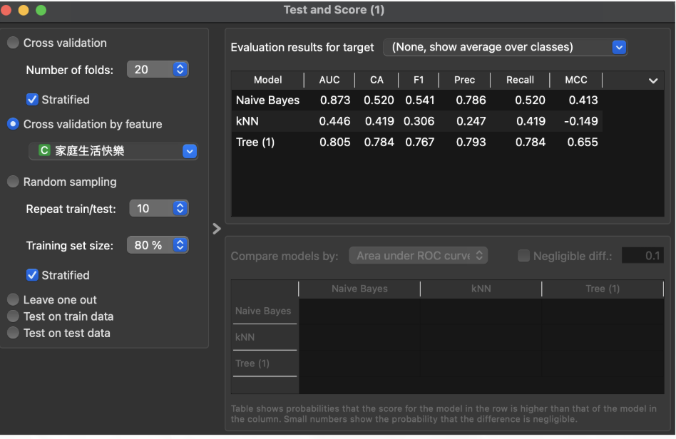
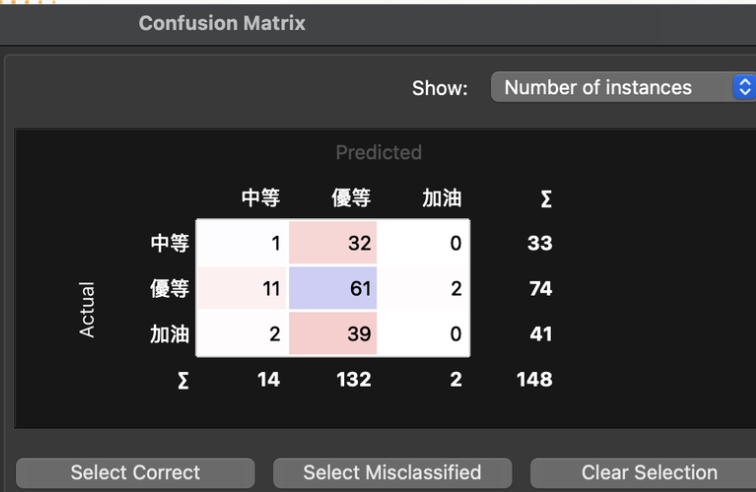

# Student Performance Classification

**Orange · Excel · Classification · Evaluation Review**

## Overview

This coursework project explores the relationship between student questionnaire features and GPA categories. I prepared the target labels in Excel, explored the data in Orange, compared Decision Tree, Naive Bayes, and kNN classifiers, and inspected confusion matrices and prediction outputs.

A review of the saved materials reveals important evaluation limitations, including GPA-derived predictors in the feature set. The project is presented as a classification and evaluation case study; the historical scores below are not evidence of validated prediction performance.

## Data preparation

The original report describes **190 student records** in the C4-2 student academic performance dataset. GPA entries mixed numeric and text formats. I created a numeric `GPA_num` field where possible and derived a three-class `GPA_level` target:

| Class | GPA range |
| --- | --- |
| High | GPA ≥ 3.70 |
| Middle | 3.20–3.69 |
| Needs support | 0.00–3.19 |

Rows without a usable target were removed. A saved confusion matrix totals **148 observations**; this is the count shown in that evaluation artifact, not a newly reproduced data-cleaning result.

Candidate features cover study time, leisure time, time management, motivation, and other questionnaire responses. Respondent-level data is not included in this portfolio.

## Modeling workflow

```text
Excel cleaning → Orange data inspection and feature review
              → Select Columns → Decision Tree / Naive Bayes / kNN
              → Test and Score → Confusion Matrix
              → Predictions for inspection
```

The supplied Orange workflow file documents the use of these components. I examined accuracy, F1, precision, recall, and AUC, and compared errors across GPA classes.

## Historical comparison



*Original coursework screenshot. These scores have not been rerun or validated with a leakage-free feature set.*

| Model | AUC | Accuracy | F1 | Precision | Recall |
| --- | ---: | ---: | ---: | ---: | ---: |
| Decision Tree | 0.805 | 0.784 | 0.767 | 0.793 | 0.784 |
| Naive Bayes | 0.873 | 0.520 | 0.541 | 0.786 | 0.520 |
| kNN | 0.446 | 0.419 | 0.306 | 0.247 | 0.419 |

In this saved output, the decision tree has the highest accuracy and F1, while Naive Bayes has the highest AUC. These metrics measure different aspects of performance. The averaging and evaluation configuration must be confirmed before drawing broader conclusions.



*Original kNN output: actual classes are rows and predicted classes are columns. This artifact shows a strong tendency to predict the high-GPA class, including no correctly classified observations in the needs-support class.*

## Evaluation review

### Target leakage

The saved Orange Rank report lists both **`GPA_num` and the original GPA field as input features**, while `GPA_level` is derived from GPA. Using these fields to predict GPA categories leaks target information. Their presence in the saved feature pipeline means the historical model scores cannot be presented as leakage-free results. The exact feature input for each recorded run is not fully documented.

A corrected experiment should exclude raw GPA, numeric GPA, and other target-derived features from the predictors. Record identifiers should also be excluded. This correction and the subsequent experiments have not yet been run.

### Cross-validation settings

The written report mentions 10-fold and 20-fold cross-validation. The saved Test and Score screenshot displays 20 folds in the standard cross-validation controls, but the selected radio option is **cross-validation by feature**, using family happiness as the grouping feature. The screenshot therefore does not establish that ordinary 20-fold stratified cross-validation produced the shown scores.

Family happiness is the grouping field in that screenshot, not the prediction target. A reproducible comparison needs one explicitly documented split strategy, identical folds across models, and a fixed seed where applicable.

### Error interpretation

The original report contains differing class-level descriptions across confusion matrices and prediction outputs. Without verifying that these refer to the same model, data, and evaluation run, they should not be combined into a single performance claim.

Likewise, selected prediction rows with probabilities near 0.5 do not prove that most errors arise at a decision boundary. A complete error analysis should quantify this across all held-out predictions. In a three-class task, a probability of 0.5 alone is not a universal boundary criterion.

## What this project demonstrates

- Converting messy GPA entries into a documented classification target.
- Comparing several model families and examining more than one metric.
- Using confusion matrices to identify class-specific failures.
- Reviewing feature provenance and evaluation settings before trusting scores.

## Next experiment

1. Remove all GPA-derived predictors and record identifiers.
2. Document the resulting sample count and class distribution.
3. Compare a majority-class baseline, Decision Tree, Naive Bayes, and kNN with the same evaluation splits.
4. Apply any imputation, scaling, or feature selection within training folds.
5. Report macro F1, class-specific recall, confusion matrices, and variation across folds.

This is a proposed experiment, not completed work. No new accuracy is claimed.

## Materials

Figures are extracted from my coursework documents. The saved Orange workflow and Rank report were used to check the analysis, but raw survey rows, local file paths, and the serialized trained model are not distributed. This repository contains a documented case study rather than a fully reproducible training package.

[Back to portfolio](../../README.md)
